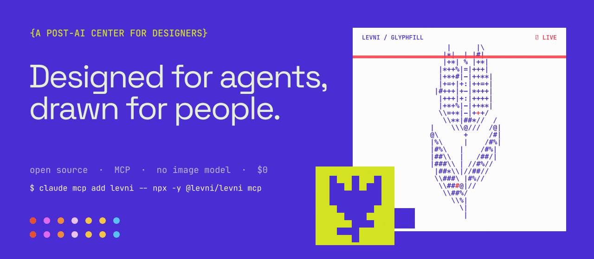
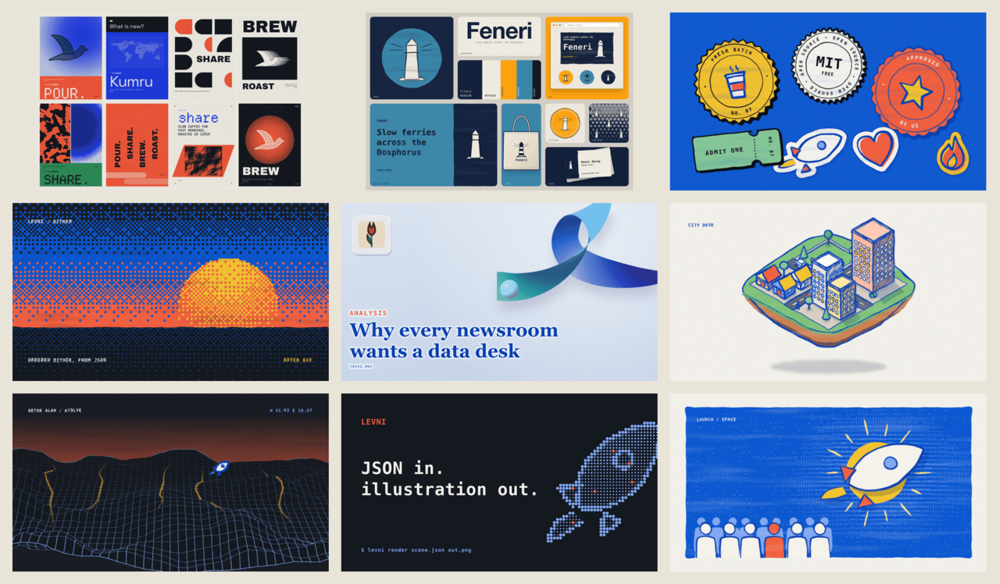
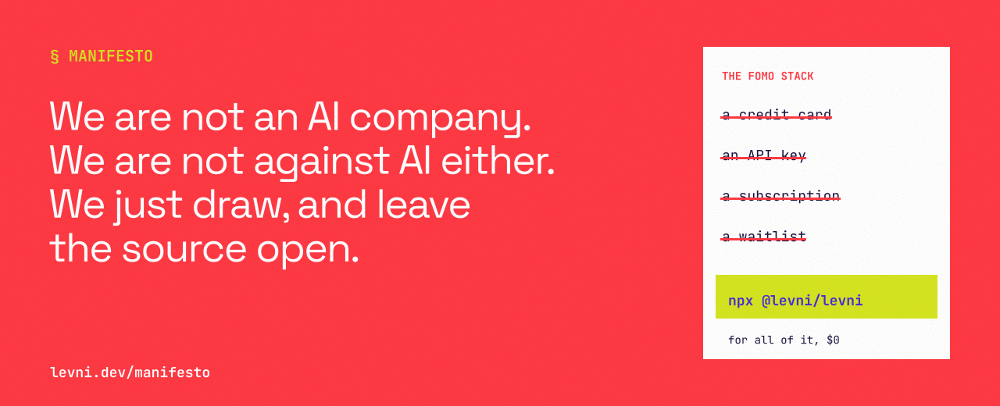
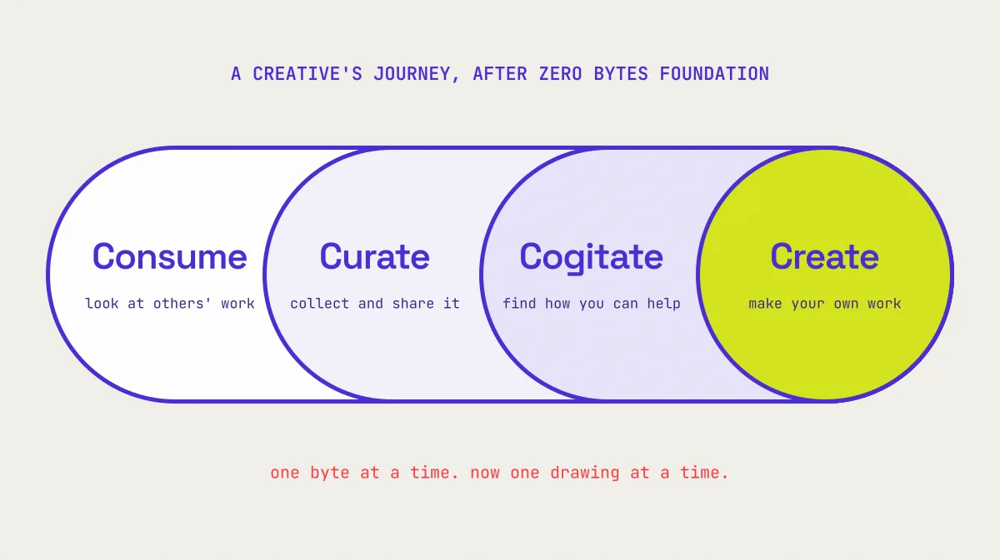
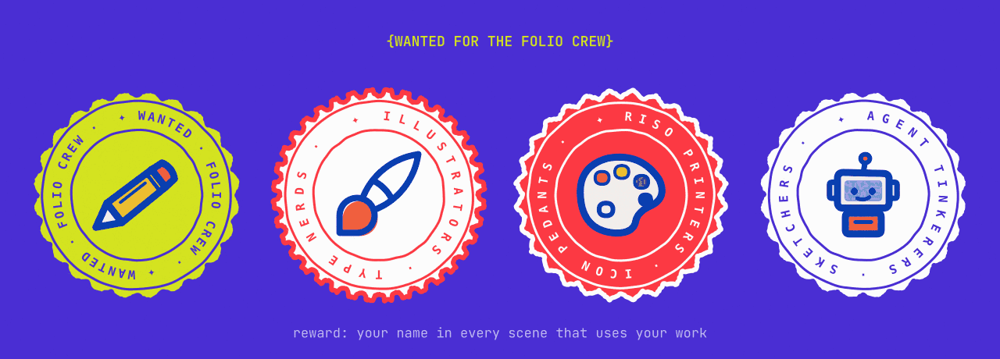
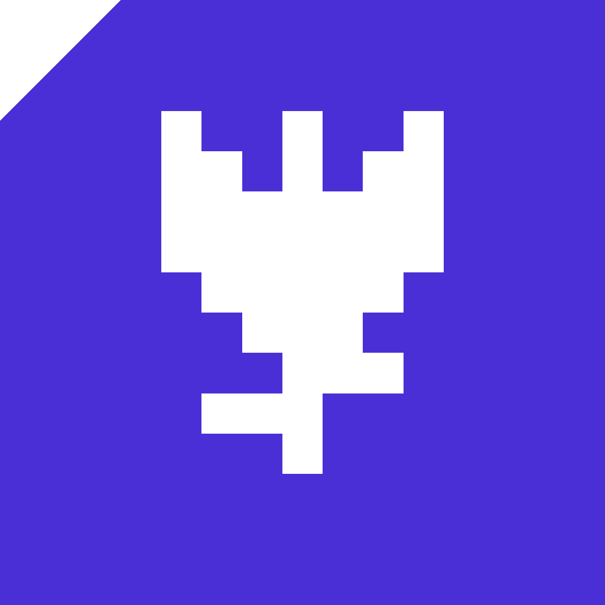

<a href="https://levni.dev"></a>

<div align="center">

[](https://www.npmjs.com/package/@levni/levni) [](https://registry.modelcontextprotocol.io/v0/servers?search=dev.levni/levni) [](https://github.com/Levni-Dev/levni/blob/main/LICENSE) [](https://creativecommons.org/licenses/by/4.0/)

**[levni.dev](https://levni.dev)** · [Editor](https://levni.dev/editor/) · [Gallery](https://levni.dev/gallery/) · [Library](https://levni.dev/library/) · [Manifesto](https://levni.dev/manifesto/) · [Community](https://levni.dev/community/)

</div>

### Your agent's design studio, open source

Levni turns a few lines of JSON into finished design work: covers, icons, charts, brand boards and whole poster series, in one hand-inked, riso-printed style. It runs on your laptop, about 0.15 s a cover, and Claude, Codex or Cursor drive it through MCP.

```bash
claude mcp add levni -- npx -y @levni/levni mcp
```

Then ask: *"Make a launch poster series for my brand with Levni."* No image model, no API key, no credit card.

<a href="https://levni.dev/gallery/"></a>

<sub>Every picture on this page was drawn by Levni from a JSON file. Same seed, same picture.</sub>

---

<a href="https://levni.dev/manifesto/"></a>

**A post-AI center for designers.** Code went open source decades ago. Fonts did, then icons. The pictures did not: one small cover now costs a credit card, an API key and a model in a good mood. We are living in a Tulip Era, where everything blooms and everything generates. Levni is the other bet: a design commons you can read, diff and keep. [Read the manifesto →](https://levni.dev/manifesto/)

---

<a href="https://levni.dev/community/"></a>

| | in Levni |
| --- | --- |
| **Consume** | browse the [gallery](https://levni.dev/gallery/): every image ships with the scene that drew it |
| **Curate** | reprint the library in your palette with a [style pack](https://levni.dev/blog/share-style-pack-palette/) |
| **Cogitate** | [request a drawing](https://github.com/Levni-Dev/levni/issues/new?template=prop-request.yml) or argue with the layout critic |
| **Create** | [draw one object for the Folio](https://levni.dev/blog/contribute-drawing-open-library/), your name stays on it |

<sub>The mantra is borrowed, with love, from our friend Berk Boz and <a href="https://medium.com/zero-bytes-foundation/what-if-we-imagined-a-studio-669f954a05f7">Zero Bytes Foundation</a>.</sub>

---

<a href="https://levni.dev/community/"></a>

**Wanted for the Folio crew:** illustrators, type nerds, riso printers, icon pedants, agent tinkerers, prompt sceptics, OSS maintainers, brand people, miniature fans, people who still sketch. So far one studio drew 1,600+ drawings. Be the second name. [Five ways in →](https://levni.dev/community/)

| repo | what |
| --- | --- |
| [**levni**](https://github.com/Levni-Dev/levni) | the engine, the Levni Folio, the CLI, the MCP server and [levni.dev](https://levni.dev) |

### No FOMO lists

We spotlight other people's open work. Open licence, free to start, maintained. That is the whole rule.

| list | what |
| --- | --- |
| [**awesome-open-design**](https://github.com/Levni-Dev/awesome-open-design) | 100+ open design tools, icon sets, illustrations, fonts, colour and creative code |
| [**awesome-design-mcp**](https://github.com/Levni-Dev/awesome-design-mcp) | 55 open-source MCP servers that let AI agents do design work |
| [**awesome-lettering**](https://github.com/Levni-Dev/awesome-lettering) | 86 open type tools, fonts, lettering and kinetic type resources |


<details>
<summary><sub>psst</sub></summary>

```text
        .   .   .
       /|\ /|\ /|\        go to levni.dev and type
      ( @@@@@@@@@ )       ↑ ↑ ↓ ↓ ← → ← → B A
       \@@@@@@@@@/
        \@@@@@@@/         or just type: levni
          \@@@/
            |
    ~~~~~~~~|~~~~~~~~
```

</details>

<div align="center">


<sub>Made by the <a href="https://ortakalan.io">Ortak Alan</a> crew, same people as <a href="https://cartcurt.xyz">cartcurt.xyz</a>. Named after Levni, court painter of the Tulip Era.<br>No image model was harmed in the making of this profile.</sub>
</div>
